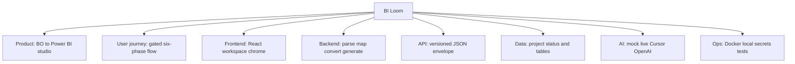
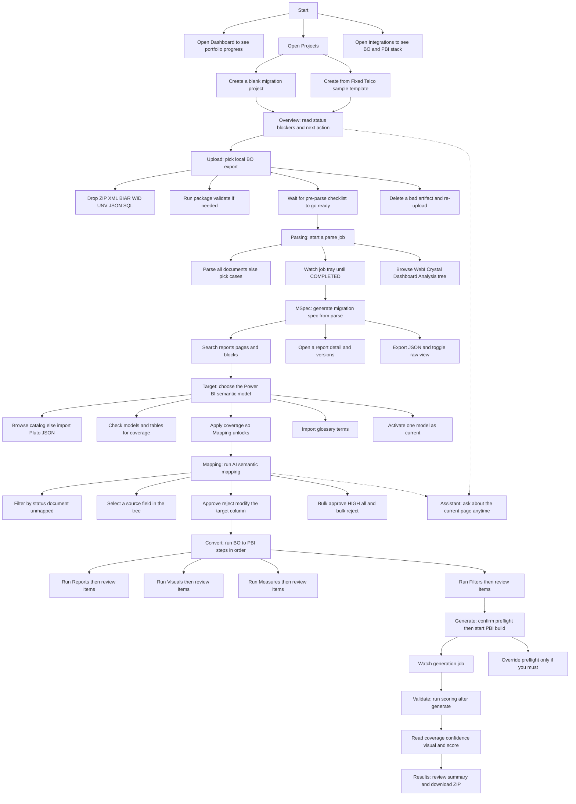
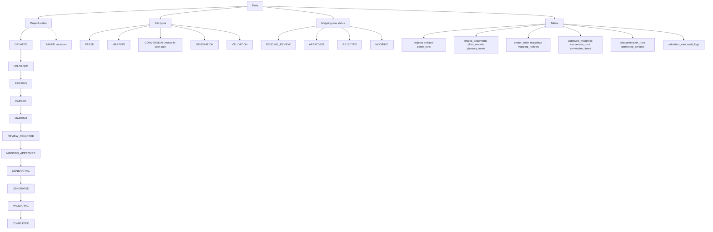

# BI Loom — application documentation mind map

Source: `README.md`, `docs/api.md`, `docs/PRODUCTION_UPGRADE_PLAN.md`, frontend routes, and backend routers.

Each leaf is written as **what the user, operator, or system on their behalf does**.

## Overview

---

## User journey

### Start

| Step | User action | Unlocks |
|------|-------------|--------|
| Dashboard | Open portfolio progress across projects | — |
| Projects | Create a blank project, or **Create from sample template** | Overview |
| Integrations | Confirm source is SAP BO and target is Power BI | — |

### 1. Overview

Read project status, blockers, and the header **Continue** CTA. Continue is enabled; it sends you to Upload.

### 2. Ingest

| Sub-step | User action | Continue when |
|----------|-------------|---------------|
| Upload | Choose **Local file** (live SAP BO pull is not available yet). Drop or browse ZIP / XML / BIAR / WID / UNV / JSON / SQL. Optionally validate the package. Confirm the pre-parse checklist. Delete and retry if the file is wrong. | Artifact uploaded and checklist ready |
| Parsing | Click **Start parsing** for the whole export, or run documents case by case. Watch the job tray. Browse the document tree (WebI, Crystal, Dashboard, Analysis). | Parse job `COMPLETED` |
| MSpec | Click **Generate MSpec**. Search reports, pages, and blocks. Open a report and version history. Export JSON or toggle raw view. | MSpec exists and is not a pending draft |

### 3. Target Model

Browse the catalog or import `pluto-model.json`. Check models and tables for coverage, then **Apply**. Import glossary JSON. Activate the model you want Mapping to use.

Continue when an **active** target model exists.

### 4. Mapping

Click **Run AI Mapping**. Filter by status, document, or unmapped-only. Select a source field, inspect the target schema, then **Approve**, **Reject**, or **Modify** the column. Use bulk approve HIGH / all, or bulk reject. Ask the assistant if a mapping is unclear.

Continue when every mapping is reviewed (approved or modified with a target). Rejected rows still need a target or they block Convert.

### 5. Convert

Steps are sequential. For each one, click **Run**, then review items:

1. **Reports** — report structure
2. **Visuals** — visual conversion
3. **Measures** — measures and formulas
4. **Filters** — filters and variables

Continue to the next convert step only after the current one is complete. After Filters, Continue goes to Deliver.

### 6. Deliver

| Sub-step | User action | Continue when |
|----------|-------------|---------------|
| Generate | Confirm the preflight checklist (mapping + convert done). Click **Generate PBI**. Watch the job. Override preflight only if you must. | Generation `COMPLETED` |
| Validate | Click **Run validation**. Read coverage, confidence, visuals, and the weighted score. | Validation `COMPLETED` |
| Results | Review the summary and **Download** the Power BI ZIP. | End of journey |

### Assistant (any page)

Ask about the current step, next action, or sample-data path. History stays in the right-hand panel and is sent back as LLM context.

---

## Product

```mermaid
flowchart TB
  Product["Product"]
  Product --> Purpose
  Product --> Source
  Product --> Target
  Product --> Differentiator
  Product --> Output
  Product --> Sample

  Purpose["Purpose"]
  Purpose --> PrP1["Run an AI assisted SAP BO to Power BI studio"]
  Purpose --> PrP2["Follow export parse mspec map review generate validate"]

  Source["Source"]
  Source --> PrS1["Take SAP Business Objects exports"]
  Source --> PrS2["Accept WebI Crystal Dashboard Analysis"]
  Source --> PrS3["Drop ZIP XML JSON SQL BIAR WID UNV files"]

  Target["Target"]
  Target --> PrT1["Land on Microsoft Power BI"]
  Target --> PrT2["Map onto the Pluto gold layer model"]

  Differentiator["Differentiator"]
  Differentiator --> PrD1["Use AI mapping plus SME review"]
  Differentiator --> PrD2["Retrieve Pluto columns with pgvector"]
  Differentiator --> PrD3["Gate each phase with Continue"]

  Output["Output"]
  Output --> PrO1["Download a pbip package ZIP"]
  Output --> PrO2["Get SemanticModel TMDL and report folders"]
  Output --> PrO3["Read migration report and unsupported list"]

  Sample["Sample template"]
  Sample --> PrSa1["Create from Fixed Telco Orders"]
  Sample --> PrSa2["Still upload the ZIP in Ingest"]
  Sample --> PrSa3["Reuse bundled Pluto model and glossary"]
```

| Step | Who | What they do |
|------|-----|----------------|
| Purpose | User | Migrate SAP BO reports into Power BI instead of rebuilding them by hand |
| Source | User | Bring WebI, Crystal, Dashboard, and Analysis exports as ZIP, XML, JSON, SQL, BIAR, WID, UNV |
| Target | User | Map onto the existing Pluto gold-layer semantic model, not a blank PBI file |
| Differentiator | User + SME | Let AI propose column matches, then approve, reject, or modify before generate |
| Output | User | Download a `.pbip` ZIP with SemanticModel TMDL, report folders, migration report, unsupported list |
| Sample | User | Create from **Fixed Telco Orders**. The template seeds the project; you still upload the demo ZIP in Ingest |
| Storage | System | Keep `{STORAGE_PATH}/{project_id}/uploads`, `source/extracted`, `generated`. `sample-data/` is read-only |

---

## Frontend

```mermaid
flowchart TB
  Frontend["Frontend"]
  Frontend --> Stack
  Frontend --> Chrome
  Frontend --> Routes
  Frontend --> Gates
  Frontend --> Jobs
  Frontend --> AssistUI

  Stack["Stack"]
  Stack --> FeSt1["Use React TypeScript Vite Tailwind"]
  Stack --> FeSt2["Query with TanStack and route with React Router"]
  Stack --> FeSt3["Apply Google Material tokens"]

  Chrome["Chrome"]
  Chrome --> FeC1["Use app bar for Dashboard Projects Integrations"]
  Chrome --> FeC2["Stay in project shell with header and phase sidebar"]
  Chrome --> FeC3["Click Continue in the project header"]
  Chrome --> FeC4["Read lock tooltips on gated substeps"]

  Routes["Routes"]
  Routes --> FeR1["Open Dashboard Projects Integrations"]
  Routes --> FeR2["Open Overview Ingest Target Map Convert Deliver"]
  Routes --> FeR3["Use ingest substeps artifacts parsing mspec"]
  Routes --> FeR4["Use deliver substeps generate validate results"]

  Gates["Gates"]
  Gates --> FeG1["Let PhaseRouteGuard block locked phases"]
  Gates --> FeG2["Let FlowNavGroup show status pips"]
  Gates --> FeG3["Follow ingest and convert step redirects"]

  Jobs["Jobs"]
  Jobs --> FeJ1["Watch the job tray poll until COMPLETED"]
  Jobs --> FeJ2["Read Activity lines in the assistant"]

  AssistUI["Assistant UI"]
  AssistUI --> FeA1["Toggle and resize the right-hand panel"]
  AssistUI --> FeA2["Send a question scoped to this project"]
  AssistUI --> FeA3["Clear history when starting over"]
```

| Step | User action | What they see |
|------|-------------|---------------|
| Stack | Open the SPA in the browser | React 19, Vite, Tailwind, Roboto, Google Material tokens |
| App bar | Click **Dashboard**, **Projects**, **Integrations** | Product mark + global nav |
| Project shell | Work inside a project | Breadcrumb, status badge, **Continue**, phase sidebar |
| Continue | Click the header CTA | Jumps to the next unlocked step |
| Sidebar | Expand a phase | Substeps with status pips; locked steps show a tooltip |
| Routes | Navigate Overview → Ingest → Target → Map → Convert → Deliver | Ingest: artifacts / parsing / mspec. Deliver: generate / validate / results |
| Gates | Try a locked URL | `PhaseRouteGuard` redirects to the allowed substep |
| Job tray | Start parse, map, generate, validate | Tray polls `GET /jobs/{id}` until `COMPLETED` |
| Activity | Watch the assistant | Job progress lines appear in the Activity card |
| Assistant | Toggle, resize, send, clear | History is per-project and sent back as LLM context |

---

## Backend

```mermaid
flowchart TB
  Backend["Backend"]
  Backend --> Serve
  Backend --> Parse
  Backend --> Spec
  Backend --> MapEng
  Backend --> ConvEng
  Backend --> GenEng
  Backend --> Store

  Serve["Serve"]
  Serve --> BeS1["Run FastAPI with async SQLAlchemy"]
  Serve --> BeS2["Mount routers under api v1"]

  Parse["Parse"]
  Parse --> BeP1["Detect BO export structure"]
  Parse --> BeP2["Parse WebI Crystal Dashboard Analysis SQL"]
  Parse --> BeP3["Build an asset inventory"]

  Spec["MSpec"]
  Spec --> BeM1["Store a pending draft on the parse run"]
  Spec --> BeM2["Persist MSpecDocument on Generate"]

  MapEng["Map"]
  MapEng --> BeMa1["Extract source objects from MSpec"]
  MapEng --> BeMa2["Match exact then normalized then vector"]
  MapEng --> BeMa3["Ask the LLM for remaining fields"]
  MapEng --> BeMa4["Upsert mappings with confidence"]

  ConvEng["Convert"]
  ConvEng --> BeC1["Materialize items for Reports Visuals Measures Filters"]
  ConvEng --> BeC2["Keep workspace trees for source and target"]

  GenEng["Generate"]
  GenEng --> BeG1["Write SemanticModel TMDL"]
  GenEng --> BeG2["Write report definition files"]
  GenEng --> BeG3["Zip pbip plus migration report"]

  Store["Store"]
  Store --> BeSt1["Save uploads under project storage"]
  Store --> BeSt2["Extract ZIP into source extracted"]
  Store --> BeSt3["Write generated files for download"]
  Store --> BeSt4["Search Pluto objects with pgvector"]
```

| Step | Who | What happens |
|------|-----|----------------|
| Serve | Operator | FastAPI monolith, async SQLAlchemy, routers under `/api/v1` |
| Detect | System | `detect_export_structure` classifies the upload |
| Parse | System | WebI, Crystal, Dashboard, Analysis, SQL parsers fill an asset inventory |
| MSpec draft | System | Parse stores a pending spec on `ParseRun`; status becomes `PARSED` |
| Generate MSpec | User click → system | Persist `MSpecDocument` and set the active version |
| Map | User click → system | Extract sources → exact / normalized / pgvector → LLM for leftovers → upsert with confidence |
| Convert | User click → system | Materialize `ConversionItem` rows for Reports, Visuals, Measures, Filters |
| Generate | User click → system | Write TMDL, `.pbir` reports, `unsupported-items.json`, `migration-report.md`, ZIP |
| Validate | User click → system | Weighted score: coverage, confidence mix, visual conversion |
| Store | System | `{project_id}/uploads`, `source/extracted`, `generated`. Vector index on Pluto import |
| Services | System | Project, Artifact, Parse, Pluto, Mapping, Conversion, Generation, Validation, Workflow, Chat |

---

## API

```mermaid
flowchart TB
  API["API"]
  API --> Envelope
  API --> ProjectsApi
  API --> ArtifactsApi
  API --> IngestApi
  API --> TargetApi
  API --> MappingApi
  API --> ConvertApi
  API --> DeliverApi
  API --> ChatApi

  Envelope["Envelope"]
  Envelope --> ApE1["Return success data error request_id"]
  Envelope --> ApE2["Poll jobs by id for async steps"]

  ProjectsApi["Projects"]
  ProjectsApi --> ApP1["Create list get delete a project"]
  ProjectsApi --> ApP2["Create from sample template"]
  ProjectsApi --> ApP3["Read dashboard and workflow"]

  ArtifactsApi["Artifacts"]
  ArtifactsApi --> ApA1["Upload list delete files"]
  ArtifactsApi --> ApA2["Validate a package without saving"]
  ArtifactsApi --> ApA3["Read the preparse checklist"]

  IngestApi["Ingest"]
  IngestApi --> ApI1["Start parse and poll parse-status"]
  IngestApi --> ApI2["Generate get search MSpec"]
  IngestApi --> ApI3["Open report detail and versions"]

  TargetApi["Target"]
  TargetApi --> ApT1["Browse catalog and compare models"]
  TargetApi --> ApT2["Import activate delete a Pluto model"]
  TargetApi --> ApT3["Apply table coverage"]
  TargetApi --> ApT4["Import and list glossary terms"]

  MappingApi["Mapping"]
  MappingApi --> ApM1["Run AI mapping async"]
  MappingApi --> ApM2["List filter get a mapping"]
  MappingApi --> ApM3["Approve reject modify one row"]
  MappingApi --> ApM4["Bulk approve HIGH all and bulk reject"]

  ConvertApi["Convert"]
  ConvertApi --> ApC1["Get workspace and latest run"]
  ConvertApi --> ApC2["Run a conversion step"]
  ConvertApi --> ApC3["List and patch item status"]

  DeliverApi["Deliver"]
  DeliverApi --> ApD1["Start generate and poll status"]
  DeliverApi --> ApD2["Start validate and read results"]
  DeliverApi --> ApD3["Download the Power BI ZIP"]

  ChatApi["Chat and ops"]
  ChatApi --> ApH1["Post chat and stream SSE tokens"]
  ChatApi --> ApH2["Read AI status and health"]
```

| Group | User / client action | Endpoint idea |
|-------|----------------------|---------------|
| Envelope | Always parse `{ success, data, error, request_id }` | All `/api/v1` |
| Projects | Create, list, get, delete; create from template | `/projects`, `/projects/from-template` |
| Dashboard | Open portfolio counts | `GET /dashboard` |
| Workflow | Read phases, blockers, next action | `GET /projects/{id}/workflow` |
| Artifacts | Upload, list, delete, validate, checklist | `/projects/{id}/artifacts` |
| Parse | Start job, poll until done | `POST /parse`, `GET /parse-status`, `GET /jobs/{id}` |
| MSpec | Generate, get, search, report, versions | `/projects/{id}/mspec` |
| Target | Catalog, import JSON, activate, coverage, glossary | `/target-models/catalog`, `/projects/{id}` Pluto routes |
| Mapping | Run AI, list, approve / reject / modify, bulk | `/projects/{id}/mapping` |
| Convert | Workspace, run step, list items, patch status | `/projects/{id}/conversion` (sync HTTP, no job row) |
| Generate | Start job, poll | `POST /generate` |
| Validate | Start job, read score | `POST /validate` |
| Results | Summary + ZIP download | `GET /results`, `GET /download` |
| Chat | Send message; stream tokens | `POST /chat`, `POST /chat/stream` (SSE `token` `status` `done` `error`) |
| Health | Check liveness | `GET /health`, `GET /ai/status` |
| Docs | Open Swagger | `http://localhost:8000/docs` |

Async jobs (parse, mapping, generate, validate) return a `job_id`. Conversion runs in the same HTTP request.

---

## Data

| Step | Who | What happens |
|------|-----|----------------|
| CREATED | User creates project | Empty project; Overview is open |
| UPLOADED | User drops artifacts | Checklist can go ready |
| PARSING → PARSED | User starts parse | `ParseRun` + pending MSpec draft |
| MAPPING → REVIEW_REQUIRED | User runs AI mapping | Rows land `PENDING_REVIEW` with HIGH / MEDIUM / LOW |
| MAPPING_APPROVED | User finishes review | Convert unlocks |
| GENERATING → GENERATED | User generates PBI | `GenerationRun` + files on disk |
| VALIDATING → COMPLETED | User runs validation | Score stored; download stays available |
| FAILED | System | Any job error; user retries the step |
| Mapping rows | User | `PENDING_REVIEW` → `APPROVED` / `REJECTED` / `MODIFIED` |
| Confidence | System | HIGH ≥ 90, MEDIUM ≥ 70, else LOW (env thresholds) |
| Postgres | Operator | pgvector extension; Alembic `001` `002` `003` |

---

## AI

```mermaid
flowchart TB
  AI["AI"]
  AI --> Modes
  AI --> LivePath
  AI --> Confidence
  AI --> WhereUsed

  Modes["Modes"]
  Modes --> AiMock["Use mock mode with no live LLM"]
  Modes --> AiLive["Use live mode with a provider key"]

  LivePath["Live path"]
  LivePath --> AiC1["Prefer Cursor Cloud Agents with crsr key"]
  LivePath --> AiC2["Fall back to OpenAI if Cursor key is empty"]
  LivePath --> AiC3["Fall back to mock if no keys"]

  Confidence["Confidence"]
  Confidence --> AiK1["Score exact match around 95"]
  Confidence --> AiK2["Score normalized partial up to 85"]
  Confidence --> AiK3["Bucket HIGH MEDIUM LOW"]

  WhereUsed["Where used"]
  WhereUsed --> AiW1["Mapping job asks LLM for leftovers"]
  WhereUsed --> AiW2["Assistant streams thoughts and replies"]
  WhereUsed --> AiW3["Parse generate validate stay rule based"]
  WhereUsed --> AiW4["Embeddings stay local hash not an API"]
```

| Step | Who | What they do |
|------|-----|----------------|
| Mock | Operator sets `AI_MODE=mock` | Deterministic mapping + chat; no network LLM |
| Live Cursor | Operator sets `AI_MODE=live` + `CURSOR_API_KEY` | Cursor Cloud Agents SDK (`crsr_` key, `CURSOR_MODEL`, optional pool) |
| Live OpenAI | Operator leaves Cursor key empty + `OPENAI_API_KEY` | OpenAI-compatible HTTP; errors fall back to mock |
| No keys | Operator | Live requested but no keys → mock with a warning |
| Mapping | User clicks **Run AI Mapping** | Exact → normalized → pgvector → LLM JSON for the rest |
| Confidence | System | Exact ~95, normalized up to 85, then HIGH / MEDIUM / LOW buckets |
| Assistant | User sends a prompt | Template `bi_loom_assistant_v1`; SSE tokens in live, one-shot in mock |
| Not LLM | System | Parse, convert, generate, validate use rule-based progress agents |
| Embeddings | System | Local hash vectors (384 dims), not an embedding API |

---

## Ops

```mermaid
flowchart TB
  Ops["Ops"]
  Ops --> Docker
  Ops --> Local
  Ops --> Secrets
  Ops --> Env
  Ops --> Tests

  Docker["Docker"]
  Docker --> OpD1["Compose postgres backend frontend"]
  Docker --> OpD2["Open UI on 5173 API on 8000 DB on 5433"]
  Docker --> OpD3["Mount artifact data and sample-data"]

  Local["Local"]
  Local --> OpL1["Run alembic then uvicorn on 8000"]
  Local --> OpL2["Run Vite on 5173"]
  Local --> OpL3["Use Homebrew Postgres with pgvector"]

  Secrets["Secrets"]
  Secrets --> OpS1["Copy secrets cursor env via setup script"]
  Secrets --> OpS2["Put the crsr key only in that file"]

  Env["Env"]
  Env --> OpE1["Set DATABASE_URL STORAGE_PATH CORS"]
  Env --> OpE2["Set AI_MODE and confidence weights"]
  Env --> OpE3["Cap upload size and log level"]

  Tests["Tests"]
  Tests --> OpT1["Run backend pytest"]
  Tests --> OpT2["Run frontend build and lint"]
  Tests --> OpT3["Hit health for liveness"]
```

| Step | Operator action | Result |
|------|-----------------|--------|
| Docker | `cp .env.example .env` then `docker compose up --build` | UI `5173`, API `8000`, Postgres host `5433` (user/db `migration` / `bi_loom`) |
| Volumes | Compose mounts | `artifact_data`, read-only `sample-data`, `secrets/cursor.env` |
| Local API | `alembic upgrade head` then `uvicorn` on 8000 | Same app without Docker engine |
| Local UI | `npm run dev` | Vite on 5173, proxies API |
| Local DB | Homebrew Postgres + pgvector | `DATABASE_URL` points at localhost, not hostname `postgres` |
| Secrets | `./scripts/setup-secrets.sh` then edit `secrets/cursor.env` | Gitignored `crsr_` key; restart backend |
| Env | Edit `.env` | `DATABASE_URL`, `STORAGE_PATH`, `CORS_ORIGINS`, `AI_MODE`, `CONFIDENCE_*`, `SCORE_WEIGHT_*`, `MAX_UPLOAD_SIZE_MB` |
| Tests | `cd backend && pytest` | API, parser, conversion, lifecycle, chat, AI status |
| Frontend check | `npm run build` and `npm run lint` | Production bundle + oxlint |
| Health | `GET /health` | `{ status: healthy, version: 1.0.0 }` |
| Swagger | Open `http://localhost:8000/docs` | Try endpoints |

---

## Written docs

- [README.md](../README.md) — quick start, demo workflow, configuration
- [api.md](./api.md) — endpoint reference and curl demo
- [PRODUCTION_UPGRADE_PLAN.md](./PRODUCTION_UPGRADE_PLAN.md) — target IA and milestones
- Sample template: `sample-data/projects/fixed-telco-orders/README.md`
